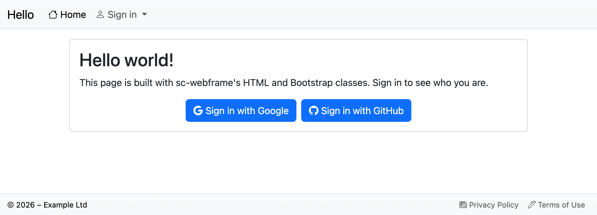

# simply-cpp-webframe

A PHP web framework: pages built from HTML and Bootstrap 5 classes, a menu that decides who may open which page,
access levels in PostgreSQL, and sign-in with Google, Microsoft, Apple, GitHub, Facebook, or a username and password. Pages load into the site
without full reloads, open in popups, side panels and toasts, and refresh themselves.

It is part of [simply-cpp](https://github.com/roelofrossouw/simply-cpp), shipped through its apt repository, but it is
plain PHP: nothing to compile, and no extension.

```php
<?php
  require_once 'sc-webframe/autoload.php';

  use BS\{Card, Button, Icon};

  Config::Init();                       // Signed in, and allowed by the menu
  Page::AddContent($Card = new Card());
  $Card->AddChild(new HTML\Header(2, 'Hello world!'));
  $Card->AddChild(new Button('Orders', Icon::Box, '/app/orders.php'));
```

## What's in it

| Part | What it does |
|---|---|
| `HTML\` | Every HTML element as a class, with the attributes and events each allows (`HTML\Spec`, from the W3Schools reference). Text is escaped. |
| `BS\` | Bootstrap 5.3 components and layout: cards, buttons, menus, forms, tables, popups (`ModalDialog`), side panels (`OffCanvas`), toasts, alerts, grids, and their enums (`Color`, `Icon`, `ScreenSize`, ...). `BS\Email` sends a page as an HTML email. |
| `Page`, `Framework` | The page being built: `Page::AddContent()` adds to it, and it is shown when the script ends, as a whole page or, for requests from `js/app.js`, as the part that changes. |
| `Config` | The settings file, and `Config::Init()`, which starts every page: the sign-in, and whether this user may open it. |
| `Auth\` | Sign-in: `Google`, `Microsoft`, `Apple`, `GitHub`, `Facebook`, each on when its section is in the settings, `Password` (users an admin adds), and `JWT`, the signed sign-in tokens (30 minutes, renewed while in use). |
| `User` | The people who signed in: their access, profile, display name and photo. |
| `MenuLayout` | The menu and status bar, built from `framework.menu`; the access levels that may view or edit each page. |
| `DB` | PostgreSQL with parameters: `Rows()`, `Row()`, `Value()`, `Assoc()`, `Exists()`, `Exec()`, `Transaction()`. |
| `Storage\` | Where users, access and the menu are kept: `Postgres` (the default), or a class of your own (`Storage\Backend`). |
| `Rest`, `Server`, `Post`, `QueryString`, `ErrorHandler` | Small helpers: an HTTP client, the request, and errors shown in the page (in full for admins). |
| `public/` | What the site serves under `/framework`: `js/app.js`, `css/style.css`, the service worker, the sign-in and sign-out pages, Forgot your password? (`resetpassword.php`), the menu (`landing.php`), Administer → Users, Menu and Config (`admin/`), Your profile (`profile.php`), and the privacy policy, terms of use and data deletion pages, written from the settings. |
| `sql/schema.sql` | The tables: `access.users`, `access.levels`, `access.grants`, `access.passwords`, `access.sign_in_failures`, `framework.menu`, `framework.menu_access`. |

The classes keep short global names (`Config`, `Page`, `DB`, `User`) and the namespaces `HTML`, `BS`, `Auth` and `Storage`,
so a site's pages read simply. A site's own classes should use their own namespace.

## Installing

On Ubuntu 24.04 (noble) or later, from simply-cpp's apt repository (see simply-cpp's README for the setup):

```bash
sudo apt install simply-cpp-webframe
```

It needs PHP 8.3 or later, with the pgsql, curl, gd and mbstring extensions (the package pulls them in). It installs:

| Where | What |
|---|---|
| `/usr/share/php/sc-webframe` | The classes and `autoload.php`, on Debian's PHP include_path |
| `/usr/share/sc-webframe/public` | The pages, scripts and styles a site serves under `/framework` |
| `/usr/share/sc-webframe/sql/schema.sql` | The database tables |
| `/usr/share/doc/simply-cpp-webframe/examples/hello` | A Hello world site |

## Setting up a site

1. **The database.** Make a PostgreSQL database for the site and load the tables, as a role that may create schemas:

   ```bash
   psql "host=db.example.com dbname=hello user=hello" -v ON_ERROR_STOP=1 -f /usr/share/sc-webframe/sql/schema.sql
   ```

   Loading it again changes nothing.

2. **The settings.** A JSON file outside the document root, readable by PHP's user only (it holds passwords), e.g.
   `/etc/hello/config.json`; see [examples/hello/config.json](examples/hello/config.json):

   | Section | Settings |
   |---|---|
   | `app` | `name`, `description`, `company`, `country`, `email` (shown in the policies), `timezone`, `home` (the page Home opens, `/home.php`), `logo`, `theme_color`, `framework_url` (`/framework`) |
   | `database` | `connection` (a libpq connection string), or `host`, `port`, `dbname`, `user`, `password`, `sslmode` |
   | `auth` | `secret` (signs the sign-in tokens: a long random string, e.g. `openssl rand -base64 48`), `keys_dir` (key files, `/etc/sc-webframe/keys`), `cache_dir` (the providers' public keys, `/var/cache/sc-webframe/jwks`), `first_admin` (see below), and a section per sign-in provider |
   | `auth.google` | `client_id`, `client_secret` |
   | `auth.microsoft` | `client_id`, `client_secret`, `tenant` (a tenant ID, or `organizations`) |
   | `auth.apple` | `client_id` (the Services ID), `team_id`, `key_id`, `key_file` (the .p8 in `keys_dir`) |
   | `auth.github` | `client_id`, `client_secret` |
   | `auth.facebook` | `app_id`, `app_secret` |
   | `auth.password` | `enabled` (`true` to offer it), `min_length` (10), `session_days` (30), `reset` (`false` to leave out Forgot your password?); see [Signing in with a password](#signing-in-with-a-password) |
   | `mail` | `from`, `redirect` (send every email there instead), `disabled` |
   | `storage` | `class`: a `Storage\Backend` of your own instead of `Storage\Postgres` |
   | `menu` | `editor`: the page that manages the menu, which admins must always keep (default: the package's `admin/menu.php`, when the menu has it; `""` for none) |

   A provider is offered once its section is there (passwords once `auth.password.enabled` is `true`). Each provider's
   redirect (callback) URL is `https://<your site>/framework/login.php`.

   PHP finds the file through the first of: the `WEBFRAME_CONFIG` constant (defined before `autoload.php`), the
   `WEBFRAME_CONFIG` environment variable (`SetEnv` in Apache, which PHP-FPM gets too), the `webframe.config` php.ini
   setting, or `/etc/sc-webframe/config.json`.

3. **The web server.** Serve the package's pages under `/framework`, and tell PHP where the settings are; see
   [examples/hello/apache.conf](examples/hello/apache.conf):

   ```apache
   Alias /framework /usr/share/sc-webframe/public
   <Directory /usr/share/sc-webframe/public>
       Require all granted
   </Directory>
   SetEnv WEBFRAME_CONFIG /etc/hello/config.json
   ```

4. **The pages.** Each starts with `require_once 'sc-webframe/autoload.php';`, or PHP adds it to every page
   (`auto_prepend_file = sc-webframe/autoload.php` in the pool's or the site's settings). A site's own classes load from
   `class/` beside its document root, or from the folders in `WEBFRAME_CLASSES`. The site needs two pages:

   - `index.php`, the page the browser opens: `Config::Init(Anonymous: true, Landing: true); Page::Landing();`. Its
     script loads the menu and Home into it.
   - `home.php`, what Home shows (the `home` menu item; `app.home` names another page).

5. **Sign in.** The first person to sign in while nobody is an admin becomes one, straight away (the sign-in token
   carries it). That's the settings' `auth.first_admin`:

   | `auth.first_admin` | Who becomes the first admin |
   |---|---|
   | `true` (the default) | Whoever signs in first |
   | `"you@example.com"` | Only someone signing in with that email address (any case) |
   | `false` | Nobody: make one by hand |

   **On a site anyone can reach, `true` lets whoever signs in first after installing take over the site**, so sign in
   straight away, or set your email address, or `false`. It only applies while nobody holds admin (a revoked grant
   doesn't count), and two first sign-ins at once can't both win. By hand:

   ```sql
   insert into access.grants (user_id, access_id)
   select user_id, access_id from access.users, access.levels where email = 'you@example.com' and code = 'admin';
   ```

   Then sign out and in again: the access you have goes into the sign-in token.

## Signing in with a password

With `"password": {"enabled": true}` in the settings' `auth` section, people can also sign in with a username (or their
email address) and a password. Nobody signs up by themselves: an admin adds them under Administer → Users (**Add a
user**: username, email, names and a first password), and sets a new password with the key button next to them. They
change their own password, names and email on Your profile.

- Passwords are kept as Argon2id hashes (bcrypt where PHP lacks Argon2), at least `min_length` characters, and not the
  username.
- A right password signs in like the other providers (the 30 minute token) and sets a session cookie that renews it for
  `session_days`. Changing the password ends every other session.
- Five wrong passwords in a row lock that user's sign-in for 15 minutes; twenty from one address in 15 minutes, across
  usernames, lock that address. Unknown usernames take as long as wrong passwords.
- **Forgot your password?** emails a link to the address the user has, which works for an hour, once. It answers the same
  whether or not the user exists. It needs mail (`mail.disabled` not `true`); `reset: false` leaves it out.

The schema since 1.3.0 adds `access.passwords` and `access.sign_in_failures`, and allows `password` as a provider; load
it again after upgrading.

## Pages and access

Every page starts with `Config::Init()`. Who may open it comes from the menu, closed by default: a page is allowed for
the access levels of the menu items that target it, and a page in no menu item for nobody.

```php
Config::Init();                                                   // A page in the menu
Config::Init(Access: '/app/orders.php', Shown: BS\Dismiss::Modal); // A popup that belongs to that page
Config::Init(Access: '/app/orders.php', Edit: true);              // Saves changes: needs the Edit right
Config::Init(Access: Config::ANY_USER);                           // Any signed in user
Config::Init(Anonymous: true);                                    // Anyone, also signed out
```

Menu items (`framework.menu`) are in a tree per section: `main` (the menu at the top), `status` (the bar at the bottom)
and `page` (in no menu: popups and pages opened from elsewhere). Each item has an icon (a Bootstrap icon class), a
target page, whether it opens in a popup, whether it is public (open to everyone), and when it shows (always, signed in,
signed out). `framework.menu_access` gives access levels the View right on an item, and with `can_edit` the Edit right
too. Add your access levels to `access.levels`, and grant them in `access.grants`.

The schema adds **Administer** to the main menu, for admins: **Users** (everyone who signed in, with a switch per access
level; admins can't take away their own admin or block themselves; with passwords on, Add a user and Set a password), **Menu** (every item, a tab per section, with
its fields, Public and Shown, and View and Edit per access level; a change that would take Menu from admins is undone)
and **Config** (the settings file by section; it saves when the web server may write the file, and never shows a secret:
a secret's field stays empty, and saving it empty keeps it).
**Your profile** is in the status bar for anyone signed in: what the site calls them, their photo, a test email, and for
password users their email and password.
Change their access in the menu like any other page's. A site's own admin pages can do the same with
`MenuLayout::Add()`, `Update()`, `SetAccess()` and `Delete()`, and `User::All()`, `User::SetAccess()` and
`User::Levels()`.

## Keeping users and the menu elsewhere

`Storage\Postgres` keeps them in the settings' database. To keep them somewhere else, behind a REST service say,
implement `Storage\Backend` and name the class in the settings:

```json
"storage": {"class": "MySite\\AgentStorage"}
```

The class loads from the site's classes like any other. Since 1.3.0 the interface includes the password users'
methods (`PasswordUserID()`, `Password()`, `AddPasswordUser()`, `SetPassword()`, `SetEmail()`, `PasswordFailed()`,
`AddressFailures()`). `DB` stays available for the site's own tables either way.

## The Hello world example

[examples/hello](examples/hello) is a whole site: `public/index.php`, `public/home.php` (Hello world!, and who you are
once signed in), the settings and the Apache site. Copy it, change the settings, load the schema, and enable the site.

What it shows before you sign in, with Google and GitHub set up:



## Building and testing

There is nothing to compile; CMake runs the tests and makes the package:

```bash
cmake -B cmake-build-local -S .
ctest --test-dir cmake-build-local --output-on-failure
```

The tests lint every file, check the settings, render pages and the menu, and check the sign-in tokens. With
`SC_WEBFRAME_TEST_DATABASE` set to a libpq connection string for an empty database, they also load the schema and
check the PostgreSQL storage against it.

## License

Apache License 2.0, see [LICENSE](LICENSE). The pages load jQuery, Bootstrap and Bootstrap Icons (MIT) from their CDNs.
