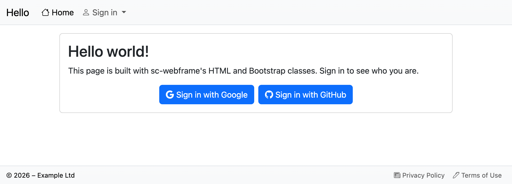

# simply-cpp-webframe

A PHP web framework: pages built from HTML and Bootstrap 5 classes, a menu that decides who may open which page,
access levels in PostgreSQL, and sign-in with Google, Microsoft, Apple, GitHub, Facebook, or an email address and password. Pages load into the site
without full reloads, open in popups, side panels and toasts, and refresh themselves.

It is part of [simply-cpp](https://github.com/roelofrossouw/simply-cpp), shipped through its apt repository, but it is
plain PHP: nothing to compile, and no extension.

```php
<?php
  require_once 'sc-webframe/autoload.php';

  use BS\{Card, Button, Icon};

  Config::Init();                       // Signed in, and allowed by the menu
  Page::AddContent($Card = new Card());
  $Card->AddChild(new HTML\Header(2, 'Hello world!'));
  $Card->AddChild(new Button('Orders', Icon::Box, '/app/orders.php'));
```

## What's in it

| Part | What it does |
|---|---|
| `HTML\` | Every HTML element as a class, with the attributes and events each allows (`HTML\Spec`, from the W3Schools reference). Text is escaped. |
| `BS\` | Bootstrap 5.3 components and layout: cards, buttons, menus, forms, tables, popups (`ModalDialog`), side panels (`OffCanvas`), toasts, alerts, grids, and their enums (`Color`, `Icon`, `ScreenSize`, ...). `BS\Toast::Notice()` says how a save, change or removal went, in the toast corner, gone after 8 seconds (15 when it didn't work; paused while the pointer is on it); a popup that held nothing else closes, unless the notice names the page to show next (`->Then($URL)`, loaded in the same place, on the tab it was on). `BS\Email` sends a page as an HTML email, formatted by bootstrap-email (sc-phplib's `SC\BootstrapEmail`, else the `bootstrap-email` program): icons are left out (mail clients lack the font), and Bootstrap 5.3 classes it doesn't know are mapped first (badge and text colours, `text-end`/`text-start`, card headers and footers, `lead`). `Html()` gives the HTML it sends, for a preview. |
| `Page`, `Framework` | The page being built: `Page::AddContent()` adds to it, and it is shown when the script ends, as a whole page or, for requests from `js/app.js`, as the part that changes. |
| `Config` | The settings file, and `Config::Init()`, which starts every page: the sign-in, and whether this user may open it. |
| `Auth\` | Sign-in: `Google`, `Microsoft`, `Apple`, `GitHub`, `Facebook`, each on when its section is in the settings, `Password` (users an admin adds), `EmailCode` (a code emailed to the address, no password), `Passkey`, and `JWT`, the signed sign-in tokens (30 minutes, renewed while in use). |
| `User` | The people who signed in: their access, profile, display name and photo. |
| `MenuLayout` | The menu and status bar, built from `framework.menu`; the access levels that may view or edit each page. |
| `DB` | PostgreSQL with parameters: `Rows()`, `Row()`, `Value()`, `Assoc()`, `Exists()`, `Exec()`, `Transaction()`. |
| `Storage\` | Where users, access and the menu are kept: `Postgres` (the default), or a class of your own (`Storage\Backend`). |
| `Rest`, `Server`, `Post`, `QueryString`, `ErrorHandler` | Small helpers: an HTTP client, the request, and errors shown in the page (in full for admins). |
| `public/` | What the site serves under `/framework`: `js/app.js`, `css/style.css`, the service worker, the sign-in and sign-out pages, Forgot your password? and password links (`resetpassword.php`), Create an account (`signup.php`), the menu (`landing.php`), Administer → Users, Menu and Config (`admin/`), Your profile (`profile.php`), and the privacy policy, terms of use and data deletion pages, written from the settings. |
| `sql/schema.sql` | The tables: `access.users`, `access.levels`, `access.grants`, `access.passwords`, `access.sign_in_failures`, `framework.menu`, `framework.menu_access`. |

The classes keep short global names (`Config`, `Page`, `DB`, `User`) and the namespaces `HTML`, `BS`, `Auth` and `Storage`,
so a site's pages read simply. A site's own classes should use their own namespace.

## Installing

On Ubuntu 24.04 (noble) or later, from simply-cpp's apt repository (see simply-cpp's README for the setup):

```bash
sudo apt install simply-cpp-webframe
```

It needs PHP 8.3 or later, with the pgsql, curl, gd and mbstring extensions (the package pulls them in). It installs:

| Where | What |
|---|---|
| `/usr/share/php/sc-webframe` | The classes and `autoload.php`, on Debian's PHP include_path |
| `/usr/share/sc-webframe/public` | The pages, scripts and styles a site serves under `/framework` |
| `/usr/share/sc-webframe/sql/schema.sql` | The database tables |
| `/usr/share/doc/simply-cpp-webframe/examples/hello` | A Hello world site |

## Setting up a site

1. **The database.** Make a PostgreSQL database for the site and load the tables, as a role that may create schemas:

   ```bash
   psql "host=db.example.com dbname=hello user=hello" -v ON_ERROR_STOP=1 -f /usr/share/sc-webframe/sql/schema.sql
   ```

   Loading it again changes nothing.

2. **The settings.** A JSON file outside the document root, readable by PHP's user only (it holds passwords), e.g.
   `/etc/hello/config.json`; see [examples/hello/config.json](examples/hello/config.json):

   | Section | Settings |
   |---|---|
   | `app` | `name`, `description`, `company`, `country`, `email` (shown in the policies), `timezone`, `home` (the page Home opens, `/home.php`), `logo`, `theme_color`, `framework_url` (`/framework`); for a shared link's preview (since 1.12.0): `share_title` (else `name`), `image` (`/img/logo-1200x900.png`; left out when the site doesn't have it; 1200 x 630 suits WhatsApp, LinkedIn and X), `image_alt` (else the title), `image_width` and `image_height` (read from a PNG or JPEG on the site) |
   | `database` | `connection` (a libpq connection string), or `host`, `port`, `dbname`, `user`, `password`, `sslmode` |
   | `auth` | `secret` (signs the sign-in tokens: a long random string, e.g. `openssl rand -base64 48`), `keys_dir` (key files, `/etc/sc-webframe/keys`), `cache_dir` (the providers' public keys, `/var/cache/sc-webframe/jwks`), `first_admin` (see below), and a section per sign-in provider |
   | `auth.google` | `client_id`, `client_secret` |
   | `auth.microsoft` | `client_id`, `client_secret`, `tenant` (a tenant ID, or `organizations`) |
   | `auth.apple` | `client_id` (the Services ID), `team_id`, `key_id`, `key_file` (the .p8 in `keys_dir`) |
   | `auth.github` | `client_id`, `client_secret` |
   | `auth.facebook` | `app_id`, `app_secret` |
   | `auth.password` | `enabled` (`true` to offer it), `min_length` (10), `session_days` (30), `signup` (`true`: anyone may make an account); it needs mail; see [Signing in with a password](#signing-in-with-a-password) |
   | `mail` | `from`, `redirect` (send every email there instead), `disabled` |
   | `ipgeolocation` | `api_key`: an [ipgeolocation.io](https://ipgeolocation.io) key; wrong-password emails then say where the try came from (city, region, country, ISP), not only its IP address |
   | `storage` | `class`: a `Storage\Backend` of your own instead of `Storage\Postgres` |
   | `admin` | `settings`: a class of the site's (an `Admin\SiteSettings`) that adds its own settings to Administer → Config; `user_columns`: one (an `Admin\UserColumns`) that adds its own columns to Users, see below |
   | `menu` | `editor`: the page that manages the menu, which admins must always keep (default: the package's `admin/menu.php`, when the menu has it; `""` for none) |

   A provider is offered once its section is there (passwords once `auth.password.enabled` is `true`). Each provider's
   redirect (callback) URL is `https://<your site>/framework/login.php`.

   PHP finds the file through the first of: the `WEBFRAME_CONFIG` constant (defined before `autoload.php`), the
   `WEBFRAME_CONFIG` environment variable (`SetEnv` in Apache, which PHP-FPM gets too), the `webframe.config` php.ini
   setting, or `/etc/sc-webframe/config.json`.

3. **The web server.** Serve the package's pages under `/framework`, and tell PHP where the settings are; see
   [examples/hello/apache.conf](examples/hello/apache.conf):

   ```apache
   Alias /framework /usr/share/sc-webframe/public
   <Directory /usr/share/sc-webframe/public>
       Require all granted
   </Directory>
   SetEnv WEBFRAME_CONFIG /etc/hello/config.json
   ```

4. **The pages.** Each starts with `require_once 'sc-webframe/autoload.php';`, or PHP adds it to every page
   (`auto_prepend_file = sc-webframe/autoload.php` in the pool's or the site's settings). A site's own classes load from
   `class/` beside its document root, or from the folders in `WEBFRAME_CLASSES`. The site needs two pages:

   - `index.php`, the page the browser opens: `Config::Init(Anonymous: true, Landing: true); Page::Landing();`. Its
     script loads the menu and Home into it.
   - `home.php`, what Home shows (the `home` menu item; `app.home` names another page).

5. **Sign in.** The first person to sign in while nobody is an admin becomes one, straight away (the sign-in token
   carries it). That's the settings' `auth.first_admin`:

   | `auth.first_admin` | Who becomes the first admin |
   |---|---|
   | `true` (the default) | Whoever signs in first |
   | `"you@example.com"` | Only someone signing in with that email address (any case) |
   | `false` | Nobody: make one by hand |

   **On a site anyone can reach, `true` lets whoever signs in first after installing take over the site**, so sign in
   straight away, or set your email address, or `false`. It only applies while nobody holds admin (a revoked grant
   doesn't count), and two first sign-ins at once can't both win. By hand:

   ```sql
   insert into access.grants (user_id, access_id)
   select user_id, access_id from access.users, access.levels where email = 'you@example.com' and code = 'admin';
   ```

   Then sign out and in again: the access you have goes into the sign-in token.

## Signing in with a password

With `"password": {"enabled": true}` in the settings' `auth` section, people can also sign in with their email address
and a password. The address is the account, and nothing about a password happens without a link emailed to it, so an
account only works once its address is shown to work (and the site needs mail):

- **Signing in** goes a step at a time, in the page under the menu when it's opened from the menu: the email address,
  then Next. With an account, the password, then Sign in; a right one goes on to the site. A wrong one emails the
  address with the IP address it came from, and where that is with `ipgeolocation.api_key` (so its owner sees someone tried, with a link to choose a new password in case it was them), and Try again
  counts down from 5 first. Without an account, the address gets a link to make one (with `signup`), and the page says
  so; an invited account gets its invitation again. This tells anyone which addresses have accounts.
- **Add a user** (Administer → Users, admins): email address and names. It emails an invitation to choose a password
  (the link works for 7 days); the list shows the account as invited until then. The key button next to a password
  account emails it a link to choose a new password (or the invitation again). Admins never see or set passwords.
- **Create an account** (`/framework/signup.php`), with `"signup": true`: anyone gives an email address, which gets a link
  (an hour) to choose names and a password; that makes the account, with Public access, and signs them in. An address
  that has an account gets a reminder to sign in or reset the password instead, and the page answers the same either
  way. On a new site, sign in as the admin first: with `auth.first_admin` at `true`, the first account would become admin.
- **Forgot your password?**, and **Your profile**'s change of password, email a link (an hour, once) to choose a new one,
  which signs you in. An account's email address never changes: to use another address, create a new account with it.

- Passwords are kept as Argon2id hashes (bcrypt where PHP lacks Argon2), at least `min_length` characters, and not the
  email address.
- A right password signs in like the other providers (the 30 minute token) and sets a session cookie that renews it for
  `session_days`. A new password ends every session, and every link sent before it.
- Five wrong passwords in a row lock that account's sign-in for 15 minutes; twenty wrong passwords or links asked for
  from one address in 15 minutes lock that address. Unknown addresses take as long as wrong passwords.

The schema since 1.3.0 adds `access.passwords` and `access.sign_in_failures`, and allows `password` as a provider; load
it again after upgrading. Since 1.5.0 the account's email address is its `subject`; 1.3.0's usernames aren't carried
over.

## Signing in with an emailed code (since 1.20.0)

With `"email": {"enabled": true}` in the settings' `auth` section, people sign in with a 6-digit code emailed to their
address: no password at all.

```json
"auth": {
  "email": {"enabled": true, "signup": true, "session_days": 30, "code_minutes": 10, "resend_seconds": 60, "hooks": "SiteEmailHooks"},
  "first_admin": false
}
```

- **Signing in**: the email address, then Next; a code goes to it, and the page asks for it in a `BS\OtpInput` (phones
  offer the code from the email). A right code signs in and sets a session cookie that renews the sign-in for
  `session_days`, as the password's does. **Send another code** waits `resend_seconds` (counting down), and
  **Use another address** starts again.
- **Signing up**: with `signup`, an address without an account gets a code too, and the right code makes the account
  (provider `email`, Public access); the site asks for the rest on its own pages. Without it, such an address gets the
  same page but no email, so the page doesn't tell which addresses have accounts. On a public site set
  `auth.first_admin` (to `false`, or your own address): by default the first account becomes admin.
- A code works `code_minutes` (10), once, and is kept as a hash. Five wrong codes in a row lock the address for 15
  minutes. Wrong codes and codes asked for count against the IP address as wrong passwords do (20 in 15 minutes).
- **Hooks**: `hooks` names a class implementing `Auth\EmailCodeHooks`, loaded from the site's classes:
  `SendCode($Email, $Code, $Minutes)` sends the code itself (say, through the site's own mail queue) and answers whether
  it went, or `null` for the framework's email; `Verified($UserID, $Email, $NewAccount)` is called once per account,
  after the first right code: its address is shown to work. `Storage\Backend::Users()` gives `verified` for these
  accounts too.

The schema since 1.20.0 adds `access.email_codes`, `access.verified_emails` and `access.passkeys`, and allows `email` as a
provider; load it again after upgrading. A storage of your own implements `Storage\EmailCodes` for it (see below).

## Passkeys (since 1.20.0)

With `"passkey": {"enabled": true}` in `auth`, and sc-phplib's `SC\Passkey` in PHP (the `sc` extension, 1.13.0 or later),
people sign in with a passkey: their phone's or computer's fingerprint, face or PIN, or a security key.

```json
"passkey": {"enabled": true, "rp_id": "www.example.com", "rp_name": "Example", "origins": ["https://www.example.com"]}
```

- `rp_id` is the domain the passkeys belong to (default the site's host), `origins` where the pages are, exact or
  `https://*.example.com` (default the site's origin), `rp_name` what authenticators may show (default `app.name`).
- **Your profile** gets a Passkeys part once signed in some other way: **Add a passkey** (with a name, e.g. My phone),
  and each passkey with when it was added and last used, and Remove. A passkey belongs to its account, whatever its
  provider (an emailed code, a password, Google ...).
- **Sign in with a passkey** on the sign-in page asks the browser for any passkey it has for the site (no address
  needed), and signs its account in as itself, with a session cookie for that provider's `session_days` (else 30).
- The checks are `SC\Passkey`'s; each challenge is kept in the PHP session and works once; a sign count that goes back
  is refused. The browser side is `/framework/js/sc-passkey.js` (sc-passkey's, copied by
  `scripts/update-sc-passkey-js.sh`) and `/framework/js/passkey.js`; `/framework/passkey.php` gives the options.

## Steps (BS\Stepper, since 1.20.0)

A form of several steps shows where it is with `BS\Stepper`: numbered steps with their names, the ones done ticked, the
current one highlighted, over a thin progress bar. On a phone the names make way for "Step 2 of 4: Cover". There's no
script: each step is a page (or a post) of its own that shows the stepper with its step current.

```php
$Card->AddChild($Steps = new BS\Stepper(['Your details', 'Firearm', 'Cover', 'Confirm'], Current: 2));
$Steps->Links(['/apply.php?step=1']); // steps done may be opened again
```

## Pages and access

Every page starts with `Config::Init()`. Who may open it comes from the menu, closed by default: a page is allowed for
the access levels of the menu items that target it, and a page in no menu item for nobody.

```php
Config::Init();                                                   // A page in the menu
Config::Init(Access: '/app/orders.php', Shown: BS\Dismiss::Modal); // A popup that belongs to that page
Config::Init(Access: '/app/orders.php', Edit: true);              // Saves changes: needs the Edit right
Config::Init(Access: Config::ANY_USER);                           // Any signed in user
Config::Init(Anonymous: true);                                    // Anyone, also signed out
```

Menu items (`framework.menu`) are in a tree per section: `main` (the menu at the top), `status` (the bar at the bottom)
and `page` (in no menu: popups and pages opened from elsewhere). Each item has an icon (a Bootstrap icon class), a
target page, whether it opens in a popup, whether it is public (open to everyone), and when it shows (always, signed in,
signed out). `framework.menu_access` gives access levels the View right on an item, and with `can_edit` the Edit right
too. Add your access levels to `access.levels`, and grant them in `access.grants`.

The schema adds **Administer** to the main menu, for admins: **Users** (everyone who signed in, with a switch per access
level; admins can't take away their own admin or block themselves; with passwords on, Add a user and the password links), **Menu** (every item, a tab per section, with
its fields, Public and Shown, and View and Edit per access level; a change that would take Menu from admins is undone)
and **Config** (the settings file by section; it saves when the web server may write the file, and never shows a secret:
a secret's field stays empty, and saving it empty keeps it). A site adds its own settings to Config with a class that implements
`Admin\SiteSettings`, named in `admin.settings`: `Groups()` gives them in the same shape as the package's
(`[group => [path => [what it is, secret]]]`), after the package's groups or added to one of the same name, and
`AfterGroup()` can show something under a group, such as a table of what those settings set up. A site adds its own
columns to Users, after Last sign-in, with a class that implements `Admin\UserColumns`, named in `admin.user_columns`:
`Headings()` gives them (`[key => heading]`), `Cell()` each user's cell, which may be a control that saves itself (a
select with `OnChange('toast.call(this, url)')` posts its `data-` values and `val` to the site's page, as the switches do).
**Your profile** is in the status bar for anyone signed in: what the site calls them, their photo, a test email, and for
password accounts a link to change the password (the address itself never changes).
Change their access in the menu like any other page's. A site's own admin pages can do the same with
`MenuLayout::Add()`, `Update()`, `SetAccess()` and `Delete()`, and `User::All()`, `User::SetAccess()` and
`User::Levels()`.

## Tables

A table's body cells are one line (since 1.11.0): text that doesn't fit is cut off with an ellipsis at 20rem, and the
full text shows in a popover when the cell is hovered, tapped or focused (only cells that are cut off get one; checked
again when the table changes size). Cells with controls in them (buttons, forms, dropdowns, progress bars) stay as
they were. Wrapping is asked for:

```php
$Headings->AddHeadingCell('Notes')->Wrap();   // the whole Notes column wraps
$Row->AddCell($Long)->Wrap();                 // this one cell wraps
$Table->Wrap();                               // every cell wraps
$Table->CellWidth('30rem');                   // how wide a one-line cell gets before it's cut off
```

Sortable headings (`TableHeadingCell::Sort()`, `DB::SortAction()`) keep the page's own query parameters (since 1.10.4).

## Popups on popups (since 1.19.0)

A button in a popup can open its page in a popup on top, e.g. an Add or Edit from a list that is itself in a popup.
The popup it came from waits as it was (its form as filled in, its tab, where it was scrolled) and shows again when the
new one closes. Popups go on top of each other as deep as needed.

```php
$Dialog->AddButton($Add = new BS\Button('Add a contact', BS\Icon::PlusLg, '/app/contact.php'));
$Add->Push();                          // the list loads again on the way back, when the contact was saved
$Edit = new BS\Button('Edit', BS\Icon::Pencil, "/app/contact.php?id=$ID");
$Edit->Push(RefreshOnReturn: false);   // the list stays exactly as it was
```

- The new popup gets a back arrow before its title. The arrow, Close (in the header or the footer), Esc and a click
  beside the popup all go back to the one under it; only the first popup really closes.
- A save in the new popup that leaves it empty (it returns a `ModalDialog` holding only a `BS\Toast::Notice()`) goes
  back too, and the popup under it loads again with its own refresh (the page it was opened with, without its action),
  unless the button said `RefreshOnReturn: false`. Without a save nothing loads again, so a half-filled form under it
  keeps what was typed.
- A `->Then($URL)` on the notice still loads that page in the same popup level instead.
- A link in any of them that loads into the page (not a popup) closes them all.
- `Push()` doesn't post the form of the popup it's in. A button that isn't in a popup opens its popup as `Modal()` does.
- In markup: class `modal-link modal-push`, `data-refresh-parent="false"` to keep the one under it as it was.

Bootstrap shows one popup at a time and doesn't support nested modals, so this keeps one: the new popup takes the old
one's place in the same `.modal`, and Bootstrap's own `hide.bs.modal` event is turned into "back" while there is one
under it. It uses nothing but Bootstrap's documented API, so Bootstrap updates don't touch it. Administer → Demos →
Popups shows it.

## Navs that overflow

A row of tabs or the menu bar can keep to one line: what doesn't fit goes into a **More** menu at its end, last
first, and comes back as room comes (Bootstrap 6's [nav overflow](https://getbootstrap.com/docs/6.0/components/nav-overflow/),
done by `js/app.js` on Bootstrap 5.3 with the same markup). It follows the width of its own place, not the window's,
so it works in a popup or a side panel too.

```php
$Tabs = (new BS\Tabs())->Overflow();
$Tabs->AddTab('Overview', $Overview, Keep: true);   // never goes into More
$Menu->Overflow(More: false, Threshold: 2);          // the button as an icon only; at least 2 items stay
$Menu->AddItem(BS\Icon::House, 'Home', '/home.php')->Keep();
```

`Overflow()` takes the button's caption (`false`: the icon only), how many items stay at least, and `CollapseBelow`
(a `BS\ScreenSize` or pixels: narrower, everything but the kept items goes into More). Choosing an entry in More
clicks the item itself, so tabs, menu items and links work as before; an item with a dropdown shows its caption as a
heading over its items. The main menu has it on (setting `menu.overflow`, `false` to fold the menu away behind its
button instead); it still folds away when even the kept items and More don't fit. For a nav of your own, put it in a
`BS\NavOverflow` and call `Enable()`.

## Dates, times and multi-selects

`BS\DatePicker` is a date field with a calendar that opens under it: Bootstrap 6's
[Datepicker](https://getbootstrap.com/docs/6.0/forms/datepicker/), done on Bootstrap 5.3 with the same library
([Vanilla Calendar Pro](https://vanilla-calendar.pro), MIT, loaded from jsDelivr) and the same `data-bs-*` attributes.
The field shows the dates written out in the page's language; the form posts them as `YYYY-MM-DD` under the field's
name: several separated by commas, a range as its first and last day. A date typed as `YYYY-MM-DD` counts too.

```php
$Due = new BS\DatePicker('due', 'Due date', '2026-11-30');
$Due->Min('2026-11-01')->Max('2026-12-31')->Required();
$Period = new BS\DatePicker('period', 'Period', Selection: BS\DateSelection::Range);
$Period->Months(2)->NoWeekends();       // also FirstWeekday(), NoPast(), Disable([...]), Calendar([...]) for any other option
```

Since 1.18.0 every plain date field gets this calendar too: an `<input type="date">` anywhere in a page, or a
`BS\Input` of `InputType::Date`. A hidden field takes its name and posts `YYYY-MM-DD` as before, so forms and their
handlers don't change; `min` and `max` become the calendar's limits, and `required`, `disabled` and `form` carry over.
Put `data-native` on the field (or on something around it) to keep the browser's own picker. Without JavaScript it
stays the browser's.

`BS\TimePicker` is a time field with columns of hours and minutes to click under it (seconds and AM/PM too if asked),
with Now, Clear and Done, like CoreUI's time picker. It shows the time as the page's language writes it (or a 12-hour
clock) and posts it 24-hour, `HH:MM` (`HH:MM:SS` with `Seconds()`); a typed time (14:30, 2:30 pm) counts, and up and
down change the minutes by the step.

```php
$Start = new BS\TimePicker('start', 'Starts at', '08:00');
$Start->Step(15)->Min('07:00')->Max('18:00')->Required();   // also TwelveHour(), Seconds()
```

`BS\MultiSelect` chooses several things from a list, like CoreUI's multi-select: what's chosen shows as chips in the
field (`Counter()`: "3 selected"), with a search that narrows the list as you type, Select all and Clear, and groups of
options. It's a plain `<select multiple>` underneath, posting `name[]` (`Post::Get('name')` is an array), so it works
with the form checks (`Required()`) like any field.

```php
$Cities = new BS\MultiSelect('cities', 'Cities', ['Gauteng' => ['jhb' => 'Johannesburg', 'pta' => 'Pretoria'],
                                                 'dbn' => 'Durban'], ['pta']);
$Cities->Max(2)->Required();            // also Counter(), NoSearch(), NoSelectAll(), Disable([...])
$Country = (new BS\MultiSelect('country', 'Country', $Countries))->Single();   // one choice, searchable
```

Keys: up and down move through the list, Enter chooses, Escape closes, Backspace in an empty search takes off the last
chip.

Since 1.17.0 a MultiSelect can also search the server as you type and take free text. `Source($url)` sends
`GET url?q=...`, debounced, and the latest answer wins; the server answers JSON `[{"value": ..., "text": ...}]`.
`Creatable()` offers "Add '...'" and adds what was typed on Enter. With either, chosen or posted values that aren't
among the options are kept.

```php
$Tags = (new BS\MultiSelect('tags', 'Tags', []))->Source('/search.php?what=tags', 2)->Creatable();
```

## More form fields (since 1.17.0)

Forms now post the browser's own `FormData`, so a name posted more than once (`name[]`) keeps every value, and files
arrive in `$_FILES`. Bootstrap is 5.3.8.

`BS\FileInput` is a drop zone you click or drop files on. `Multiple()` posts `name[]`, and files dropped later are
added to those chosen. `Accept()`, `MaxSize()` and `Preview()` (thumbnails) are there. The chosen files are listed,
each with a button to take it off; a file too big or of the wrong kind makes the field invalid.

```php
$Scan = new BS\FileInput('scan', 'Signed agreement');
$Scan->Accept('.pdf,image/*')->MaxSize(10 * 1024 * 1024)->Required();   // $_FILES['scan']
$Photos = (new BS\FileInput('photos', 'Photos'))->Multiple()->Accept('image/*')->Preview();
```

`BS\Choices` is a group of checkboxes posting `name[]`, or radios with `Single: true`. `Inline()` puts them side by
side and `Buttons(Color)` draws them as toggle buttons. For checkboxes, `Required()` means at least one is ticked.

```php
$Days = new BS\Choices('days', 'Days', ['mon' => 'Monday', 'tue' => 'Tuesday', 'wed' => 'Wednesday'], ['mon']);
$Days->Inline()->Required();
$Size = (new BS\Choices('size', 'Size', ['s' => 'Small', 'm' => 'Medium', 'l' => 'Large'], 'm', Single: true))->Buttons();
```

`BS\PasswordInput` has a show/hide button. `Strength($MinLength)` adds a strength meter (weak, fair, good, strong)
with Bootstrap 6 Strength's markup and its `strengthChange.bs.strength` event. The sign-up and reset-password pages
use it; signing in has show/hide only.

```php
$Password = (new BS\PasswordInput('password', 'Password', 'new-password'))->Strength(10)->Required();
```

`BS\DateTimePicker` puts a DatePicker and a TimePicker side by side and posts one value, `YYYY-MM-DD HH:MM` (a date
without a time posts 00:00). `Step()`, `Seconds()`, `TwelveHour()`, `Min()`, `Max()` and `Required()` are there.

```php
$Meeting = (new BS\DateTimePicker('meeting', 'Meeting', '2026-11-30 09:30'))->Step(15)->Required();
```

`BS\NumberInput` is − number unit +. It shows the number in the page's number format and posts it plain
(`1234.5`). Either decimal mark is taken when typing, and up and down step it.

```php
$Quantity = (new BS\NumberInput('quantity', 'Quantity', 1))->Min(1)->Max(99);
$Mass = (new BS\NumberInput('mass', 'Mass', 12.5, 'kg'))->Decimals(1)->Step(0.5)->Min(0);
```

`BS\OtpInput` is a one-time-code field with Bootstrap 6's OTP markup: one real input drawn as boxes, with
`autocomplete="one-time-code"` and the digit keyboard. `Groups()`, `Connected()`, `Mask()` and `Alphanumeric()` are
there; it fires `complete.bs.otpInput` when full.

```php
$Code = (new BS\OtpInput('code', 'Code from the email', 6))->Groups([3, 3])->Required();
```

The forms demo (Administer → Demos → Forms) shows each of them.

## Demos

Administer → Demos (admins only, `/framework/demos/index.php`) shows what the classes look like and do, a page per
subject: text, layout, forms (dates, times and multi-selects too), buttons, cards, alerts, components, tables, menus (nav
overflow), popups, errors, and every icon in the Bootstrap Icons site's groups, with a search and 16, 24 or 32 px
previews (click one to copy `Icon::Name`). Sites made before 1.15.0 get the menu item by loading `sql/schema.sql`
again. `scripts/update-icon-categories.py` refreshes the icons' groups and search words (`public/demos/icons.json`)
from icons.getbootstrap.com.

## Keeping users and the menu elsewhere

`Storage\Postgres` keeps them in the settings' database. To keep them somewhere else, behind a REST service say,
implement `Storage\Backend` and name the class in the settings:

```json
"storage": {"class": "MySite\\AgentStorage"}
```

The class loads from the site's classes like any other. Since 1.3.0 the interface includes the password accounts'
methods (`PasswordUserID()`, `Password()`, `AddPasswordUser()`, `SetPassword()`, `PasswordFailed()`,
`AddressFailures()`). `DB` stays available for the site's own tables either way.

Emailed codes and passkeys need two more interfaces, which `Storage\Postgres` implements; a storage of your own
implements them too to offer those sign-ins (they're only offered when it does):

```php
class SiteStorage implements Storage\Backend, Storage\EmailCodes, Storage\Passkeys { ... }
```

- `Storage\EmailCodes`: `EmailCodeUserID($Email)`, `EmailCode($Email)` (hash, expires, sent, failures, last_failure),
  `SaveEmailCode($Email, $Hash, $Expires)`, `EmailCodeFailed($Email, $Address)`, `EmailCodeUsed($Email)` and
  `EmailVerified($UserID)` (true the first time). The accounts themselves are made through `SignIn('email', ...)`.
- `Storage\Passkeys`: `Passkeys($UserID)`, `Passkey($CredentialID)`, `AddPasskey($UserID, $Credential, $Name)`,
  `PasskeyUsed($ID, $SignCount, $BackedUp)`, `RemovePasskey($UserID, $ID)` and `UserSignIn($UserID)`.

See the interfaces' comments for each method's values.

## The Hello world example

[examples/hello](examples/hello) is a whole site: `public/index.php`, `public/home.php` (Hello world!, and who you are
once signed in), the settings and the Apache site. Copy it, change the settings, load the schema, and enable the site.

What it shows before you sign in, with Google and GitHub set up:



## Building and testing

There is nothing to compile; CMake runs the tests and makes the package:

```bash
cmake -B cmake-build-local -S .
ctest --test-dir cmake-build-local --output-on-failure
```

The tests lint every file, check the settings, render pages and the menu, and check the sign-in tokens. With
`SC_WEBFRAME_TEST_DATABASE` set to a libpq connection string for an empty database, they also load the schema and
check the PostgreSQL storage against it.

## License

Apache License 2.0, see [LICENSE](LICENSE). The pages load jQuery, Bootstrap and Bootstrap Icons (MIT) from their CDNs.
